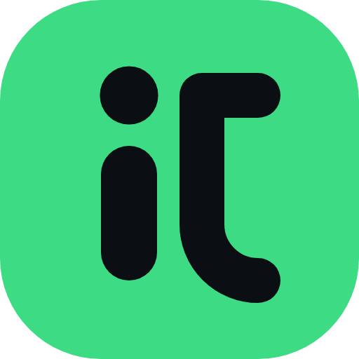

# iakimlabs

**Mobile games & apps**

An independent studio that designs, builds and publishes small, polished mobile games and apps — starting on Android, with iOS next — and helps other developers get through Google Play closed testing.

[**iakimlabs.com**](https://iakimlabs.com) · [Apps & Games](https://iakimlabs.com/apps/) · [Closed testing](https://iakimlabs.com/testing/) · [Contact](https://iakimlabs.com/contact/)

---

## Our games & apps

| | |
|---|---|
|  | **[Mouse Crumbs](https://iakimlabs.com/apps/mousecrumbs/)** — a gentle offline game where you feed a little mouse, ring a bell and watch it explore. No ads, no accounts, no purchases. 21 languages. *Now in closed testing on Google Play.* |

More games and apps are on the way.

## What we do

- 🎮 **Mobile games** — casual and arcade games for phones and tablets that are easy to pick up and hard to put down.
- 📱 **Mobile apps** — useful tools with clean interfaces and careful attention to detail.
- 👥 **Closed testing for Google Play** — engaged testers for the 12-testers / 14-days requirement for new personal developer accounts, with daily usage and honest feedback. [How it works →](https://iakimlabs.com/testing/)
- 🚀 **Publishing support** — store listing, privacy policy page and a release checklist for your first Google Play launch.

## Principles

- **Built for real phones** — designed for different screens, devices and OS versions. Android now, iOS next.
- **Small and polished** — fewer features, done properly.
- **Respect for players** — clear privacy policies and only the data an app really needs.
- **Listening to feedback** — testers and players shape every update.

## Get in touch

Need testers for your first release, or just want to say hello?
Write to **[iakimlabs@gmail.com](mailto:iakimlabs@gmail.com)** or use the [contact form](https://iakimlabs.com/contact/).

---

Website source · built with Jekyll and Bootstrap 5 · technical notes live in [`docs/`](docs/SITE-GUIDE.en.md) · Google Play and the Google Play logo are trademarks of Google LLC.
