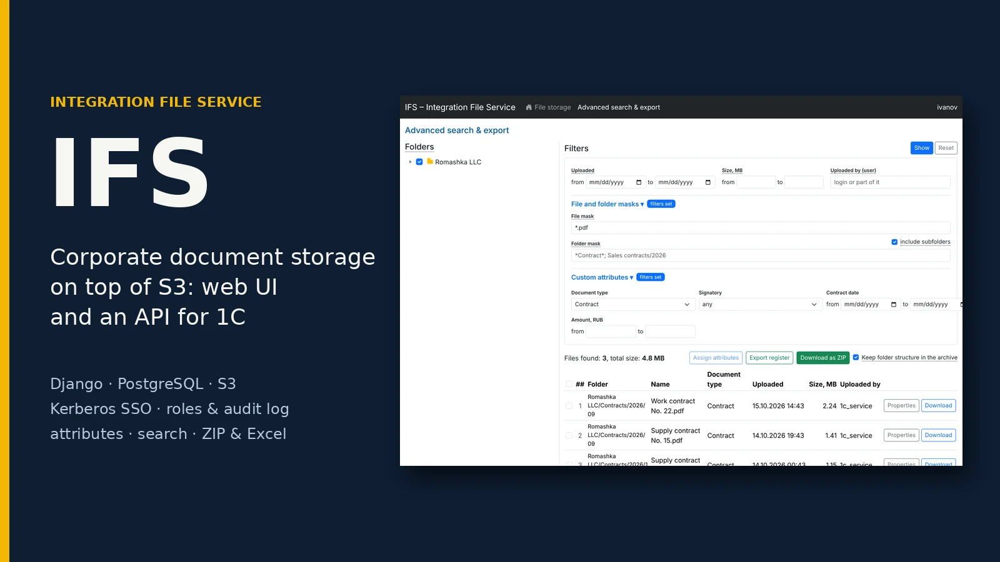

# iakimlabs

**Games & apps for mobile and PC**

An independent studio that designs, builds and publishes small, polished games and apps for mobile, Windows and Steam — starting on Android, with iOS, Windows and Steam following — and builds custom web applications.

[**iakimlabs.com**](https://iakimlabs.com) · [Apps & Games](https://iakimlabs.com/apps/) · [Web](https://iakimlabs.com/web/) · [Contact](https://iakimlabs.com/contact/)

---

## Our work

| | |
|---|---|
|  | **[Mouse Crumbs](https://iakimlabs.com/apps/mousecrumbs/)** — a gentle offline game where you feed a little mouse, ring a bell and watch it explore. No ads, no accounts, no purchases. 21 languages. *Now in closed testing on Google Play.* |
|  | **[IFS — Integration File Service](https://iakimlabs.com/web/ifs/)** — a corporate document repository on top of S3, with a web UI, an HTTP API for ERP systems, role-based access, an audit log, advanced search and ZIP / Excel export. *Web application.* |

More games and apps are on the way.

## What we do

- 🎮 **Mobile games** — casual and arcade games for phones and tablets that are easy to pick up and hard to put down.
- 📱 **Mobile apps** — useful tools with clean interfaces and careful attention to detail.
- 🪟 **Windows software** — desktop apps and utilities for Windows.
- 🕹️ **Steam games** — indie games for PC, from the first prototype to the Steam store page.
- 🌐 **Web applications** — internal systems, integrations and document platforms.

## Principles

- **Built for real phones** — designed for different screens, devices and OS versions. Mobile first, with Windows and Steam alongside.
- **Small and polished** — fewer features, done properly.
- **Respect for players** — clear privacy policies and only the data an app really needs.
- **Listening to feedback** — testers and players shape every update.

## Get in touch

Have an idea or a question?
Write to **[iakimlabs@gmail.com](mailto:iakimlabs@gmail.com)** or use the [contact form](https://iakimlabs.com/contact/).

---

Website source · built with Jekyll and Bootstrap 5 · technical notes live in [`docs/`](docs/SITE-GUIDE.en.md) · Google Play and the Google Play logo are trademarks of Google LLC.
